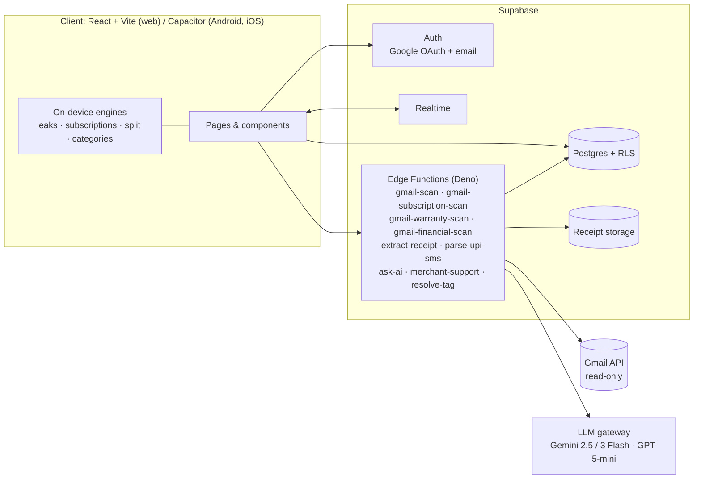

<div align="center">

# 🧾 EZZ BILL

**The digital layer for bills. UPI solved payments; EZZ BILL solves what happens after.**

Your bills arrive on their own, from Gmail, UPI SMS, receipts and an NFC tap at the restaurant table. EZZ BILL organises them and shows you where your money is leaking.

[](https://ezbill.live)
[](https://ezzbill.com)
[](https://ezzbill.com/#investors)


&nbsp;
&nbsp;
&nbsp;


<sub>Real screens from the live app, using demo data</sub>

</div>

---

## The problem

For the average Indian consumer, spending data is scattered across a dozen places:

- **Email**: Swiggy, Amazon and Uber invoices, bank and credit-card statements, and warranty cards, buried in the inbox
- **SMS**: every UPI payment sends a text that nobody reads twice
- **Paper**: restaurant and retail receipts that end up in a pocket or the bin
- **Subscriptions**: OTT, SaaS and telecom plans that renew quietly, often in duplicate

Expense apps expect you to **type all of this in by hand**, and almost nobody keeps that up past the first week. So people don't know what they spend, which subscriptions they've forgotten, or when a return window closes.

## The solution

EZZ BILL makes capture effortless so the insights are there when you need them:

| Capture (automatic) | Understand | Act |
|---|---|---|
| 📥 Gmail import (read-only) | 🕳️ Money Leaks against your personal ideal budget | ➗ Split a bill item by item with friends |
| 📱 UPI SMS parsing (Android) | 🔄 Subscription radar: unused, low-use and duplicate subscriptions | 🛡️ Warranty and return-window reminders |
| 📸 AI receipt scanning and bulk upload | 📊 Spending analytics by category and merchant | 🎧 Merchant support lookup in one tap |
| 📲 Tap an NFC/QR table tag to get the restaurant bill | 💬 Ask AI questions about your own spending | 📂 Statements organised into a Financial Docs hub |

## Features in detail

### 📥 Zero-effort capture
- **Gmail sync.** Read-only OAuth (`gmail.readonly`). The app scans for bills, subscriptions, warranties and financial documents. Hashing, a processed-email log and sync locks make sure nothing is imported twice.
- **AI receipt extraction.** Upload a photo, PDF or HEIC. The model is chosen by input type (Gemini 2.5 Flash for images and text, GPT-5-mini for PDFs, with automatic fallback). It extracts the merchant, amount, date, category and **individual line items**.
- **UPI SMS reader.** In the Android app, transaction SMS from GPay, PhonePe, Paytm, BHIM and bank alerts are filtered on the device and parsed into expenses.
- **Smart categorisation.** A merchant map tuned for India (Swiggy, Zepto, Blinkit, IRCTC, Jio, HPCL and more) assigns categories automatically.

### 🕳️ Money Leaks
A short **Money Profile** quiz covers income band, age, city tier, living situation, job type and financial goal. From it, EZZ BILL builds a **personalised ideal budget** for each category, compares it with what you actually spend, and shows the gap in rupees. It also calculates a "safe daily spend" until your next payday.

### 🔄 Subscription radar
A detection engine finds recurring merchants by cadence (weekly, monthly or yearly) and by amount. It then marks each subscription as **active, low-use, unused or duplicate**, for example two music apps. You see the total you could save each month.

### ➗ Smart Split
Split a bill **item by item** or equally. Tax and discounts are shared out proportionally, and a **friends ledger** tracks who owes whom.

### 📲 NFC Airdrop (pilot)

&nbsp;
&nbsp;
&nbsp;


A restaurant's staff photograph the closed bill and attach it to the table's **NFC tag or QR code**. The customer taps their phone and the receipt goes straight into EZZ BILL. No POS integration is needed. Bills expire after a short window so nobody sees a stranger's receipt, and the staff dashboard updates live through Supabase Realtime.

### 🛡️ Warranties, returns and support
- Warranty cards found in email are extracted automatically, and the app reminds you before a **return window closes**.
- **Merchant Support** finds the official phone number, email, help centre and order-tracking link for any merchant on a bill, with a confidence score for each.

### 💬 Ask AI
Chat with your own expense data. Ask "What did I spend on food last month?" or "Which category grew the most?" and get answers from an LLM grounded in your expenses.

### 📂 Financial Docs hub
Credit-card statements, bank statements and trade confirmations are kept out of your expense list. They're sorted into their own hub with key fields extracted: due date, minimum due and closing balance.

## On desktop

&nbsp;

## Business model

**Merchants pay. Their customers join for free.**

| Stream | Price | Why it works |
|---|---|---|
| **Merchant SaaS** | ₹499–999 per location per month | Restaurants and retailers get digital bills, NFC table-tap and fewer paper receipts |
| **Consumer premium** | ₹49–99 per month | Power features for heavy users |
| **Bill collection** | Free, always | Every merchant tap brings in a new consumer user |

## Architecture



**Design choices**
- **Pure-function engines.** Leak, subscription and split logic are side-effect-free TypeScript modules (`src/lib/*-engine.ts`). That keeps them easy to test and lets them run instantly on the client.
- **Edge Functions for anything sensitive.** OAuth tokens, Gmail calls and LLM keys never reach the browser.
- **Row Level Security on every table.** Each user can read only their own rows. Public NFC lookups go through a service-role function that returns only a short-lived signed URL.
- **Idempotent imports.** SHA-256 content hashes, a `processed_emails` log and `sync_locks` prevent duplicates when several syncs run at once.

## Tech stack

| Layer | Tools |
|---|---|
| Frontend | React 18, TypeScript, Vite, Tailwind CSS, shadcn/ui, TanStack Query, Recharts |
| Mobile | Capacitor (Android and iOS), on-device SMS inbox |
| Backend | Supabase: Postgres, Auth, Storage, Realtime, Edge Functions (Deno) |
| AI | Gemini 2.5 Flash / Pro, Gemini 3 Flash, GPT-5-mini, called through an LLM gateway |
| Integrations | Gmail API (read-only), Google OAuth |
| Testing | Vitest, Playwright |

## Product journey

EZZ BILL started as **ExpenseDesk**, a B2B tool for employee expense reimbursements with approval workflows and audit trails. Early on, we saw that the most painful step was not approval but **capture**, and that individuals feel that pain every day, not only at month-end. So the product was **repositioned for consumers**. The OCR pipeline and expense model stayed, and the product was rebuilt around automatic capture and money insights.

## Roadmap

- [x] Gmail bill, subscription, warranty and statement import
- [x] AI receipt extraction with line items
- [x] Money Leaks, Subscription radar, Smart Split
- [x] NFC/QR tap-to-claim receipts (pilot)
- [x] NFC tap habit tested in the real world with [Racked](https://github.com/omkarpatilswork/racked-app), on 10 tagged gym machines
- [ ] Android app on the Play Store with the UPI SMS reader
- [ ] Bank account aggregation (Account Aggregator framework)
- [ ] Budget alerts and weekly money digest
- [ ] Restaurant partner rollout for NFC Airdrop

## Run locally

```bash
git clone https://github.com/omkarpatilswork/ez-bill1.git
cd ez-bill1
npm install
cp .env.example .env   # add your Supabase URL and anon key
npm run dev            # http://localhost:8080
```

Edge Functions live in `supabase/functions/` and the database schema in `supabase/migrations/`.

## Built by

**Omkar Patil**, founder (ex-PM, Bajaj Finserv Health) · [omkarpatil.in](https://www.omkarpatil.in) · [LinkedIn](https://www.linkedin.com/in/omkar-patil-757ab3194/) · [omkarpatilswork@gmail.com](mailto:omkarpatilswork@gmail.com)

Built AI-first with Lovable and Supabase.
