<div align="center">

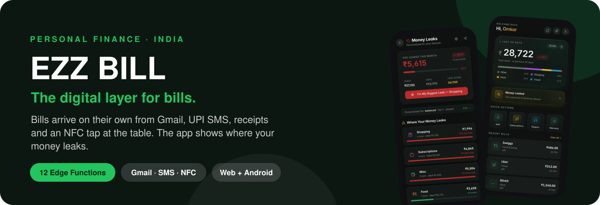

<br/>

[](https://ezbill.live)
[](https://ezzbill.com)
[](https://ezzbill.com/#investors)


**[The problem](#01--the-problem)** ·
**[The product](#02--the-product)** ·
**[How bills get in](#03--how-bills-get-in)** ·
**[Under the hood](#05--how-it-works)** ·
**[Where it stands](#07--where-it-stands)** ·
**[Limits](#08--what-it-does-not-do-yet)** ·
**[Run it](#10--run-it-yourself)**

</div>

---

> **A live, early-stage product.** The web app is live at [ezbill.live](https://ezbill.live). NFC table-tap is a pilot, and the Android app with the UPI SMS reader is not on the Play Store yet. The screens below are the real app with demo data.

---

## 01 · The problem

UPI solved payments. Nothing solved what comes after. For most people in India, spending data is scattered across a dozen places:

- **Email:** Swiggy, Amazon and Uber invoices, bank and credit-card statements, warranty cards
- **SMS:** a text for every UPI payment that nobody reads twice
- **Paper:** restaurant and shop receipts that end up in a pocket or the bin
- **Subscriptions:** OTT, SaaS and telecom plans that renew quietly, sometimes twice

Expense apps expect you to type all of this in by hand, and almost nobody keeps that up past the first week. So people don't know what they spend, which subscriptions they've forgotten, or when a return window closes.

## 02 · The product

EZZ BILL makes capture automatic, so the insights are there when you need them.

| Capture (automatic) | Understand | Act |
|---|---|---|
| Gmail import, read-only | **Money Leaks** against your own ideal budget | Split a bill item by item with friends |
| UPI SMS parsing (Android) | **Subscription radar**: unused, low-use and duplicate plans | Warranty and return-window reminders |
| AI receipt scanning and bulk upload | Spending by category and merchant | Merchant support contacts in one tap |
| Tap an NFC or QR table tag for the restaurant bill | Ask AI about your own spending | Statements sorted into a Financial Docs hub |

### Screens

<table>
<tr>
<td width="25%">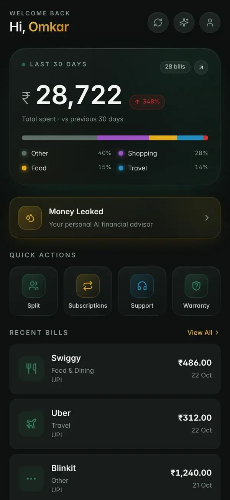<br/><sub><b>Home.</b> This month's spend, the biggest leak, quick actions and recent bills.</sub></td>
<td width="25%">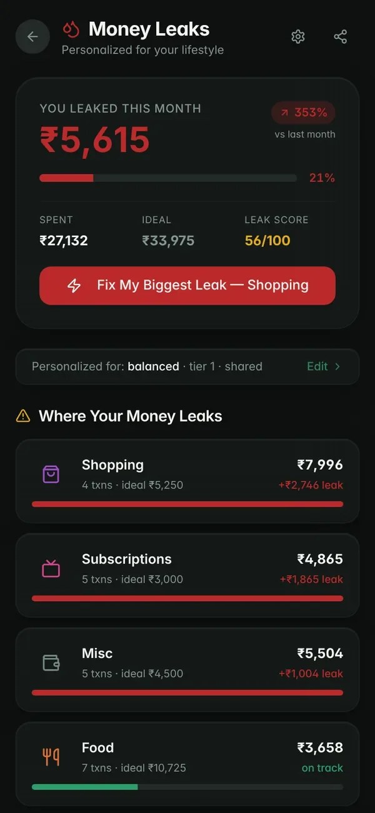<br/><sub><b>Money Leaks.</b> Each category against your ideal budget, with the gap in rupees.</sub></td>
<td width="25%">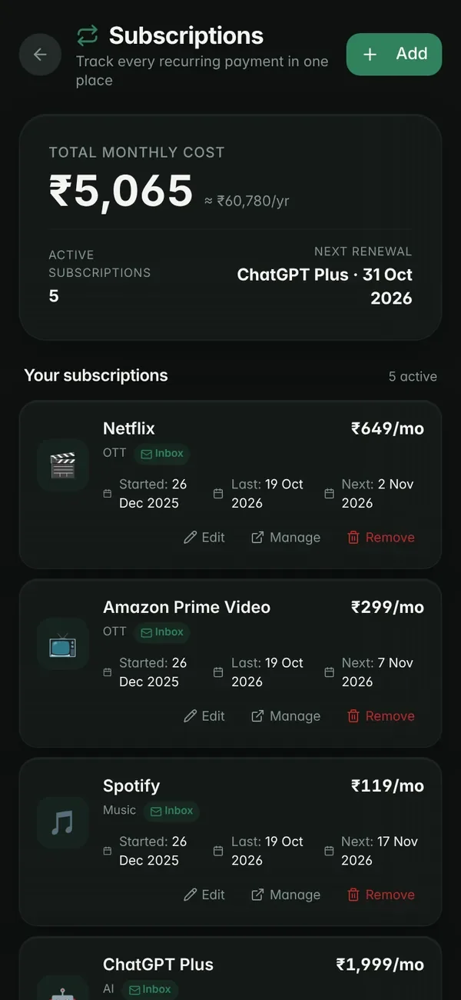<br/><sub><b>Subscription radar.</b> Recurring charges found by cadence, flagged unused, low-use or duplicate.</sub></td>
<td width="25%">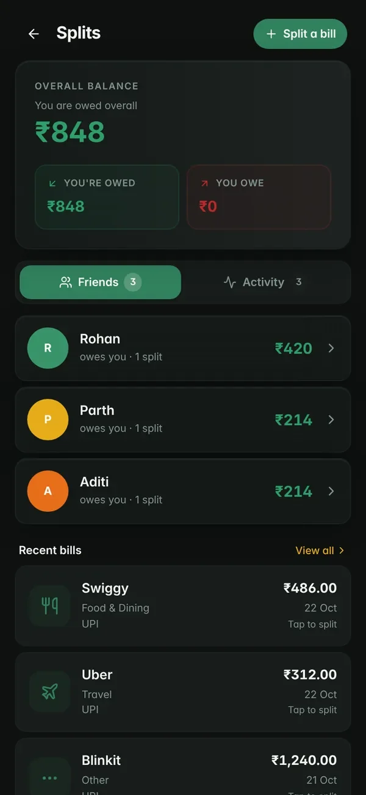<br/><sub><b>Smart Split.</b> Split by item or equally, with tax shared out and a friends ledger.</sub></td>
</tr>
</table>

<table>
<tr>
<td width="50%">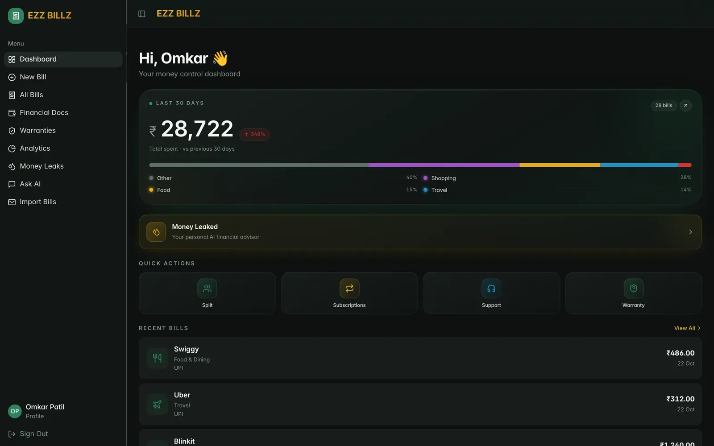<br/><sub><b>Desktop dashboard.</b> The same app at full width.</sub></td>
<td width="50%">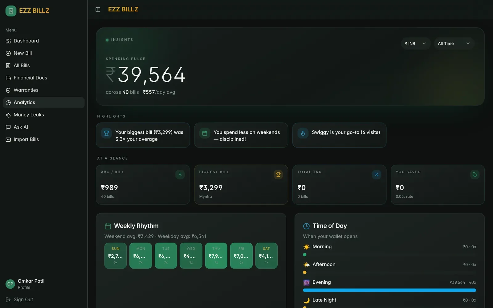<br/><sub><b>Analytics.</b> Spending by category and merchant over time.</sub></td>
</tr>
</table>

## 03 · How bills get in

| Channel | How it works |
|---|---|
| **Gmail** | Read-only OAuth (`gmail.readonly`). Separate scans look for bills, subscriptions, warranties and financial statements. Content hashes, a processed-email log and sync locks stop anything being imported twice. |
| **Receipts** | Upload a photo, PDF or HEIC. The model is picked by input type (Gemini 2.5 Flash for images and text, GPT-5-mini for PDFs, with fallback) and extracts merchant, amount, date, category and **line items**. |
| **UPI SMS** | In the Android app, transaction texts from GPay, PhonePe, Paytm, BHIM and banks are filtered on the device and parsed into expenses. |
| **NFC / QR table tag** | The restaurant pilot below. |

A merchant map tuned for India (Swiggy, Zepto, Blinkit, IRCTC, Jio, HPCL and more) assigns categories automatically.

### NFC Airdrop (pilot)

<div align="center">
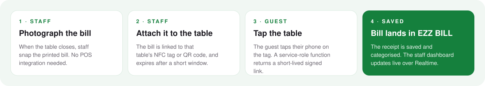
</div>

<table>
<tr>
<td width="25%">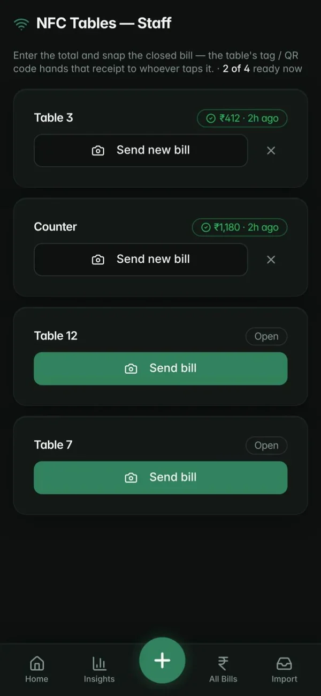<br/><sub><b>Staff.</b> Send a table's bill.</sub></td>
<td width="25%">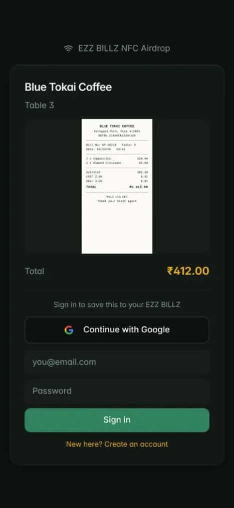<br/><sub><b>Guest.</b> Tap the table.</sub></td>
<td width="25%">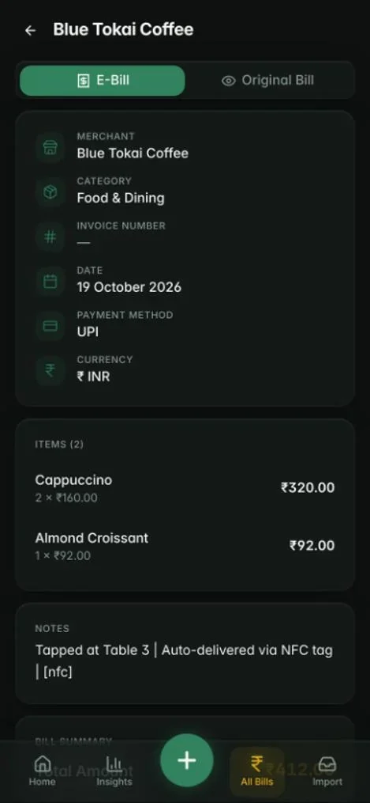<br/><sub><b>The bill</b> on your phone.</sub></td>
<td width="25%">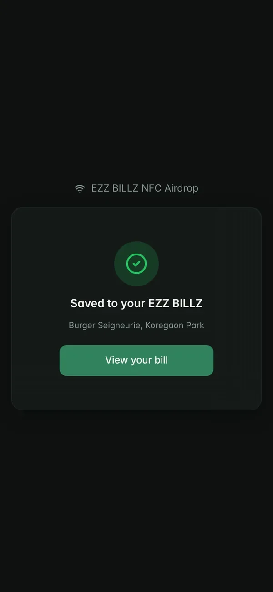<br/><sub><b>Saved</b> to EZZ BILL.</sub></td>
</tr>
</table>

No POS integration is needed. Bills expire after a short window so nobody sees a stranger's receipt. The tap habit was tested in the real world with [Racked](https://github.com/omkarpatilswork/racked-app), on 10 tagged gym machines.

## 04 · What's inside

<details open>
<summary><b>Money Leaks</b></summary>
<br/>

A short **Money Profile** quiz covers income band, age, city tier, living situation, job type and financial goal. EZZ BILL turns it into a personal ideal budget per category: rent and EMI are carved out first (capped at 60% of income), then the rest is budgeted by your goal. It compares that with what you actually spend, shows the gap in rupees, and works out a safe daily spend until payday. The logic is one pure function, `computeIdealBudget()` in [`src/lib/leak-engine.ts`](src/lib/leak-engine.ts).
</details>

<details>
<summary><b>Subscription radar</b></summary>
<br/>

Finds recurring merchants by cadence (weekly, monthly, yearly) and amount, then marks each one **active, low-use, unused or duplicate** (two music apps, for example), with the total you could save each month. See [`subscription-engine.ts`](src/lib/subscription-engine.ts).
</details>

<details>
<summary><b>Smart Split</b></summary>
<br/>

Split a bill item by item or equally. Tax and discounts are shared out proportionally, and a friends ledger tracks who owes whom. See [`split-engine.ts`](src/lib/split-engine.ts).
</details>

<details>
<summary><b>Warranties, returns and merchant support</b></summary>
<br/>

Warranty cards found in email are extracted automatically, with a reminder before a return window closes. Merchant Support finds the official phone, email, help centre and order-tracking link for a merchant on a bill, each with a confidence score.
</details>

<details>
<summary><b>Ask AI and the Financial Docs hub</b></summary>
<br/>

Ask questions like "What did I spend on food last month?" and get answers grounded in your own expenses. Credit-card statements, bank statements and trade confirmations are kept out of the expense list and sorted into their own hub, with the due date, minimum due and closing balance pulled out.
</details>

## 05 · How it works

<div align="center">
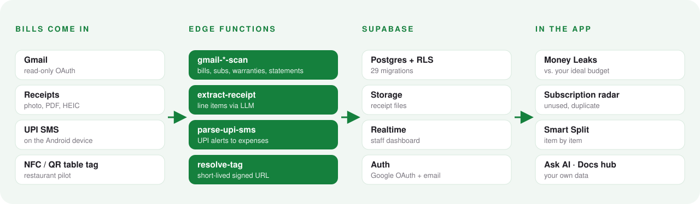
</div>

**Design choices**

- **Pure-function engines.** Leak, subscription and split logic are side-effect-free TypeScript modules (`src/lib/*-engine.ts`). They run instantly on the device and are easy to test.
- **Edge Functions for anything sensitive.** OAuth tokens, Gmail calls and LLM keys never reach the browser. There are 12 functions in [`supabase/functions/`](supabase/functions).
- **Row-level security on every table.** Each user can read only their own rows. Public NFC lookups go through a service-role function that returns only a short-lived signed URL.
- **Idempotent imports.** SHA-256 content hashes, a `processed_emails` log and `sync_locks` prevent duplicates when several syncs run at once.

<details>
<summary><b>Stack</b></summary>
<br/>

| Layer | What's used |
|---|---|
| **Frontend** | React 18, TypeScript, Vite, Tailwind CSS, shadcn/ui, TanStack Query, Recharts |
| **Mobile** | Capacitor (Android and iOS), on-device SMS inbox on Android |
| **Backend** | Supabase: Postgres, Auth, Storage, Realtime, Edge Functions (Deno) |
| **AI** | Gemini 2.5 Flash / Pro, Gemini 3 Flash and GPT-5-mini through an LLM gateway |
| **Integrations** | Gmail API (read-only), Google OAuth |
| **Testing** | Vitest and Playwright |

</details>

## 06 · Business model

**Merchants pay. Their customers join free.**

| Stream | Price | Why it works |
|---|---|---|
| **Merchant SaaS** | ₹499–999 per location per month | Digital bills, NFC table-tap and less paper for restaurants and shops |
| **Consumer premium** | ₹49–99 per month | Power features for heavy users |
| **Bill collection** | Free, always | Every merchant tap brings in a new consumer |

## 07 · Where it stands

|  |  |
|---|---|
| **Status** | Web app live at [ezbill.live](https://ezbill.live). Marketing and investor site at [ezzbill.com](https://ezzbill.com) ([repo](https://github.com/omkarpatilswork/ezzbill-site)). |
| **Mobile** | Capacitor Android and iOS builds exist. Not on the Play Store or App Store yet. |
| **NFC Airdrop** | Pilot. Works end to end; no restaurant rollout yet. |
| **Backend** | 12 Edge Functions and 29 database migrations. |
| **Tests** | Unit tests cover the Money Leaks engine (9 cases). Vitest and Playwright are set up, but most of the app has no automated tests yet. |
| **How it's built** | AI-first, with Lovable and Supabase. 700+ commits. |

**How it got here.** EZZ BILL started as **ExpenseDesk**, a B2B tool for employee expense claims with approvals and audit trails. The painful step turned out not to be approval but **capture**, and individuals feel that every day, not just at month end. So the product was repositioned for consumers: the OCR pipeline and expense model stayed, and everything else was rebuilt around automatic capture and money insights.

## 08 · What it does not do (yet)

- **No bank account linking.** Spending comes from email, SMS, receipts and taps, not from your bank. Account Aggregator support is on the roadmap.
- **The SMS reader is Android only**, and iOS doesn't let apps read SMS at all.
- **AI extraction can be wrong.** Receipts and emails are parsed by language models; amounts and categories can be edited.
- **Ideal budgets are rules of thumb**, built from a six-question profile. They're not financial advice.
- **NFC needs staff to act.** A restaurant has to photograph and attach the bill; there's no POS integration.
- **No budget alerts or weekly digest yet.**

## 09 · What's next

- [x] Gmail bill, subscription, warranty and statement import
- [x] AI receipt extraction with line items
- [x] Money Leaks, Subscription radar, Smart Split
- [x] NFC / QR tap-to-claim receipts (pilot)
- [x] NFC tap habit tested with [Racked](https://github.com/omkarpatilswork/racked-app) on 10 gym machines
- [ ] Android app on the Play Store with the UPI SMS reader
- [ ] Bank account aggregation (Account Aggregator framework)
- [ ] Budget alerts and a weekly money digest
- [ ] Restaurant partner rollout for NFC Airdrop

## 10 · Run it yourself

You'll need Node 20+ and a Supabase project.

```bash
git clone https://github.com/omkarpatilswork/ez-bill1.git
cd ez-bill1
npm install
cp .env.example .env   # add your Supabase URL, project ID and publishable key
npm run dev            # http://localhost:8080
```

```bash
npm test               # Vitest
npm run build          # production build
```

Edge Functions live in `supabase/functions/` and the schema in `supabase/migrations/`. Gmail import and AI extraction need their own Google OAuth client and LLM keys set as Supabase function secrets.

## Repository map

```
ez-bill1/
├── src/
│   ├── pages/              Dashboard, MoneyLeaks, Subscriptions, Splits, AskAI,
│   │                       FinancialDocs, Warranties, NfcAirdrop, StaffTables, …
│   ├── components/         UI, bills, charts
│   ├── lib/                leak-, subscription- and split-engine (pure functions)
│   └── integrations/       Supabase client
├── supabase/
│   ├── functions/          12 Edge Functions: gmail-*, extract-receipt, parse-upi-sms,
│   │                       ask-ai, merchant-support, resolve-tag, …
│   └── migrations/         29 Postgres migrations with row-level security
├── capacitor.config.ts     Android and iOS shells
└── docs/                   screenshots and README diagrams
```

---

<div align="center">
<sub>Built by <a href="https://www.omkarpatil.in">Omkar Patil</a>, founder (ex-PM, Bajaj Finserv Health) · <a href="https://www.linkedin.com/in/omkar-patil-757ab3194/">LinkedIn</a> · <a href="mailto:omkarpatilswork@gmail.com">omkarpatilswork@gmail.com</a></sub>
</div>
